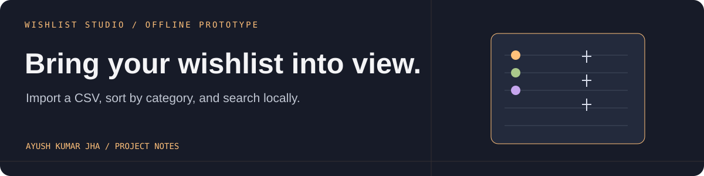

# Wishlist Deal Tracker



Keep the things you are waiting to buy in one list, log prices as you check them, and know when a price is actually a deal, not just a "sale" banner.

## Open the app

**https://ayushkjha.github.io/Amazon-Wishlist-filter/**

Works with any store, including Amazon. You log prices yourself; the app does not read store websites, so there is nothing to sign in to and no data leaves your browser.

## Features

- **Price history per item:** log today's price in one tap and see the trend, the lowest price so far and the change since last time.
- **Target prices:** set what you are willing to pay; items at or below it are flagged.
- **Deal score:** ranks items by how far they are below their peak, whether they hit your target, and whether this is the lowest price yet.
- **Budget planner:** enter a budget and get the best set of items that fits, with must-haves first, then wants, then nice-to-haves.
- **Filter and sort** by category, priority, biggest drop, lowest price or best deal, or show deals only.
- **Import** from CSV (`name, price, target, category, url, priority, notes`; only name is required, currency symbols are fine) and export a JSON backup.
- Rupee, dollar, euro and pound display; works on phones; follows your light or dark theme.

Items saved by the earlier version of this page are brought over automatically the first time you open it.

## Develop

Requires Node.js 22 or newer.

```sh
npm test
```

Deal scoring, the budget planner and CSV import live in [docs/lib/deals.js](docs/lib/deals.js) and are unit-tested without a browser. To run the page locally, serve `docs/` with any static server, for example `python -m http.server --directory docs`.

## Earlier record-keeping server

`server.mjs` is the original version: a small Node.js server that stores wishlist records in SQLite under `data/`. Start it with `node server.mjs` (Node.js 24 or newer).
