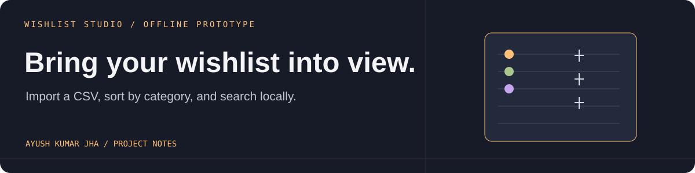

# Wishlist Studio



An offline browser prototype exploring a simple way to bring wishlist items into one searchable view.

## Try it

Open `index.html` in a browser. The starting list contains illustrative sample items; use the CSV upload or paste field to load your own rows. Expected columns, in order:

```csv
product name,category,current price
Wireless headphones,Electronics,149.99
```

Search the imported list by product name and filter it by category.

### Use the prototype

1. Open `index.html` in a modern browser.
2. Upload a CSV or paste rows with the columns `product name,category,current price` in that order.
3. Search by product name, then type a category in the category-filter field to narrow the visible rows.
4. Import a different CSV to replace the current in-memory list. Reloading the page restores the illustrative sample data.

The browser demo does not save imported rows between reloads. It does not log in to Amazon or fetch wishlist items or current deals.

## Current scope

This is an early front-end prototype. It does not connect to Amazon, fetch live wishlist contents, monitor sale events, or verify current prices. The sample items and prices are illustrative. Import a CSV you have prepared yourself; the app does not scrape websites.

The repository also contains a Node.js/SQLite single-owner workspace scaffold. It is separate from the standalone browser demo; the current browser interface uses its sample list and imported CSV in memory.

## Run the workspace scaffold

Requires Node.js 24 or newer:

```sh
npm start
```

Once the server is running, open [http://127.0.0.1:4320](http://127.0.0.1:4320) on the same laptop. If that port is already used by another project, run `$env:PORT=4321; node server.mjs` in PowerShell and open `http://127.0.0.1:4321`. To expose the scaffold beyond your computer, set `HOST=0.0.0.0`, a strong `APP_PASSWORD` (at least 16 characters), HTTPS, and durable database storage.

The scaffold is a separate local workspace. Use its typed forms to create or edit records, search them, and import or export CSV/JSON where offered. Its persistent SQLite records are not used by the standalone wishlist demo.
